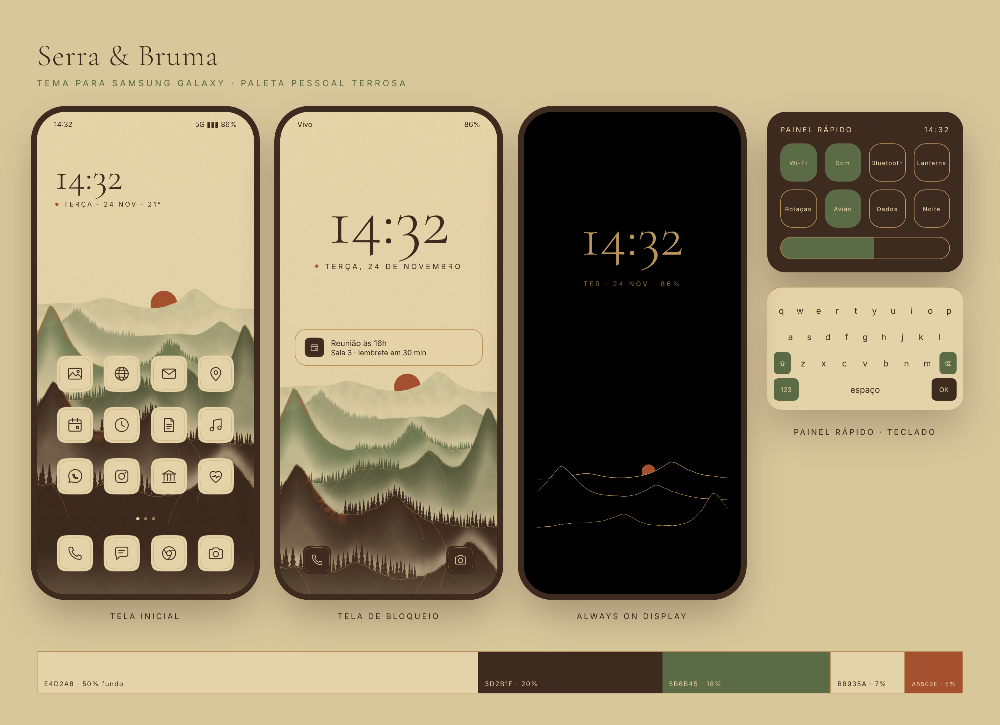

# Serra & Bruma: tema para Samsung Galaxy



Um tema sóbrio com floresta e serra, feito só com a sua paleta pessoal.

| Cor | Papel | Onde aparece |
|---|---|---|
| `#E4D2A8` (50%) | Fundo dominante | Céu e bruma do papel de parede, azulejos dos ícones, teclado, cartões |
| `#3D2B1F` (20%) | Contraste acentuado | Serras da frente, glifos dos ícones, painel rápido, textos e relógio |
| `#5B6B45` (18%) | Decoração | Serras com pinheiros do meio, botões ligados, barras de brilho e volume, teclas de função |
| `#B8935A` (7%) | Só traço fino | Fio nas cristas, contorno interno dos ícones, bordas de botões desligados, ponteiros/AOD |
| `#A5502E` (5%) | Detalhe pessoal | Sol, encostas iluminadas, ponto da data, selos de notificação, tecla Enter |

> **Regra seguida:** `#B8935A` nunca preenche área. Até a lua da versão noturna é só um anel.

---

## Conteúdo da pasta

```
00_PREVIA_DO_TEMA.png              Prévia de todas as telas
papeis_de_parede/
  01_tela_inicial.png              1440×3200 (serra mais alta, sol acima dos ícones)
  02_tela_bloqueio.png             1440×3200 (mais céu livre para o relógio)
  04_aod_always_on_display.png     1080×1080, fundo preto puro (economiza bateria no OLED)
  05_noturno_opcional.png          Variante escura para o modo noturno
icones/
  papel/    40 ícones: azulejo E4D2A8, glifo 3D2B1F   ← recomendado para a tela inicial
  carvao/   40 ícones: azulejo 3D2B1F, glifo E4D2A8   (para o papel noturno)
  musgo/    40 ícones: azulejo 5B6B45, glifo E4D2A8   (para pastas ou destaques)
  lista_icones.json                Qual ícone combina com qual app
fonte/                             Scripts que geraram tudo (dá para regenerar ou ajustar)
```

Todas as imagens são 1440×3200 e cobrem telas QHD+ e FHD+ (S21–S25, A5x, Z Fold etc.). O sistema corta as bordas sozinho.

---

## Uma limitação importante

Um tema **instalável pela Galaxy Store** (.apk assinado) só pode ser gerado pelo *Samsung Theme Designer*, que é exclusivo para parceiros aprovados pela Samsung. Por isso este kit foi feito para o **Theme Park**, o módulo oficial de temas da Samsung dentro do Good Lock. O resultado no aparelho é um tema completo: papel de parede, ícones, painel rápido, teclado, volume e cores do sistema.

---

## Passo a passo

### 0. Preparar
1. Copie a pasta `papeis_de_parede` e a pasta `icones/papel` para o celular (Drive, cabo USB ou Quick Share).
2. Na **Galaxy Store**, instale o **Good Lock** e, dentro dele, o módulo **Theme Park**.
3. Em *Configurações → Tela*, deixe o **Modo claro** ativo. O tema foi feito sobre fundo papel. Se for usar o noturno, veja a seção 7.

### 1. Criar o tema base (Theme Park → Tema → Criar novo)
1. Escolha `01_tela_inicial.png` como imagem.
2. O Theme Park sugere cores a partir da imagem. **Não aceite a sugestão automática.** Abra a edição de cores e digite os HEX abaixo.
3. Os nomes dos campos mudam um pouco entre as versões do One UI. Procure pelo componente:

| Componente | Cor |
|---|---|
| Cor principal / destaque | `#5B6B45` |
| Fundo de diálogos e janelas | `#E4D2A8` |
| Texto principal | `#3D2B1F` |
| Texto secundário | `#5B6B45` |
| Selo de notificação (badge) | `#A5502E` |

4. Salve com o nome **Serra & Bruma** e aplique.

### 2. Painel rápido (Theme Park → Painel rápido)
| Item | Cor |
|---|---|
| Fundo do painel | `#3D2B1F` (transparência 0–10%) |
| Botão **ligado** | `#5B6B45` |
| Ícone do botão ligado | `#E4D2A8` |
| Botão **desligado** | `#3D2B1F` |
| Ícone e texto do botão desligado | `#E4D2A8` |
| Barra de brilho (preenchida) | `#5B6B45` |
| Barra de brilho (trilho) | `#3D2B1F` |
| Cartões de notificação | fundo `#E4D2A8`, texto `#3D2B1F` |

> Desfoque do fundo: **baixo ou desligado**. Um desfoque forte deixa o painel com cara de vidro fosco genérico.

### 3. Teclado (Theme Park → Teclado)
Teclado sem bordas, no tom do papel:

| Item | Cor |
|---|---|
| Fundo | `#E4D2A8` |
| Teclas de letra | `#E4D2A8` (mesma cor do fundo, ou seja, sem caixas) |
| Texto das teclas | `#3D2B1F` |
| Teclas de função (⇧ ⌫ 123) | `#5B6B45`, texto `#E4D2A8` |
| Enter | `#3D2B1F`, texto `#E4D2A8` (ou `#A5502E` se quiser o detalhe pessoal) |
| Efeito ao tocar | `#B8935A` |

### 4. Painel de volume (Theme Park → Volume)
Fundo `#3D2B1F`, barra preenchida `#5B6B45`, trilho `#3D2B1F`, ícones `#E4D2A8`.

### 5. Ícones (Theme Park → Ícone → Criar novo)
1. Em *Configurações de ícone*, desative o fundo e a forma automáticos (os PNGs já têm o azulejo).
2. Toque em cada app → **Escolher da Galeria** → selecione o PNG correspondente em `icones/papel/`.
3. O arquivo `lista_icones.json` diz qual ícone combina com qual app. Os principais:

| Arquivo | App |
|---|---|
| telefone, mensagens, contatos, camera, galeria | Apps padrão Samsung |
| internet / navegador | Samsung Internet / Chrome |
| email | Gmail / Outlook |
| whatsapp, instagram, telegram | Redes |
| banco, carteira | Bancos, Samsung Wallet, Pix |
| saude, relogio_pulso, casa | Samsung Health, Wearable, SmartThings |
| video, musica, livros | YouTube/Netflix, Spotify, Kindle |
| carro, comida, mapas | Uber/99, iFood, Maps/Waze |
| pinheiro, montanha, folha | Pastas e apps sem ícone próprio |

4. Para apps que não estão na lista, use `pinheiro`, `montanha` ou `folha`. Assim a tela não fica com ícones fora do tema.

### 6. Tela de bloqueio e AOD
1. *Configurações → Tela de bloqueio → Editar*: use `02_tela_bloqueio.png`.
2. Relógio: escolha o estilo mais fino e serifado disponível, na cor **`#3D2B1F`**. Notificações: estilo **ícone apenas** ou cartão claro.
3. *Always On Display → Estilo do relógio → Imagem*: escolha `04_aod_always_on_display.png` e a cor do relógio **`#B8935A`**.

### 7. Opcional: modo noturno
Use `05_noturno_opcional.png` com os ícones `carvao`. No Theme Park, inverta as cores: fundo de diálogo `#3D2B1F`, texto `#E4D2A8`. O resto (painel, volume) já é escuro e continua igual.

---

## Ajustes finais recomendados
- **Grade da tela inicial 4×5 ou 4×6**, com poucos ícones. O céu livre faz parte do desenho.
- **Ocultar nomes dos apps**: se a sua versão do One UI não tiver essa opção, use o módulo *Home Up* do Good Lock. Os rótulos brancos do sistema quebram a paleta.
- **Widget de relógio**: use o widget "Relógio digital" sem fundo, texto `#3D2B1F`, no canto superior esquerdo.
- **Fonte do sistema**: uma serifa fina (como uma Garamond) combina com a prévia. Na Galaxy Store, procure em *Fontes*. Se não gostar de nenhuma, mantenha a padrão Samsung One, que é neutra.
- **Não use** papéis de parede dinâmicos, widgets coloridos de terceiros ou pacotes de ícones com sombra. Isso desmonta a sobriedade do tema.

---

## Sobre as proporções
Medidas por pixel no papel da tela inicial: cerca de **47% papel · 28% carvão · 13% musgo**. A bruma mistura papel e musgo e cai em tons intermediários. O ouro aparece só como fio fino.

O **ferrugem fica abaixo de 1% no papel de parede** (sol e encostas iluminadas). Os 5% dele no tema vêm dos pontos de detalhe: data, selos de notificação e Enter. Ferrugem em mais área deixaria o tema chamativo. Se quiser mais, os scripts em `fonte/` permitem aumentar o sol ou as encostas.
